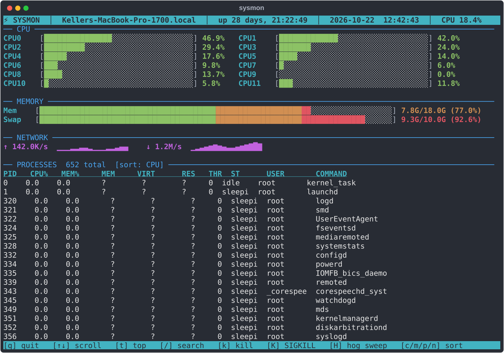
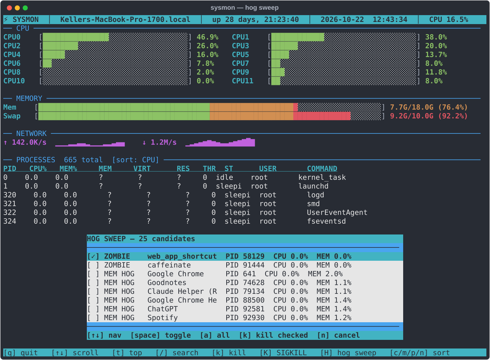

# sysmon

An htop-style terminal system monitor written in Python.



## Install

```bash
pip install psutil
```

## Run

```bash
python3 sysmon.py
```

Or add an alias:

```zsh
alias htop='python3 ~/Developer/sysmon/sysmon.py'
```

## What it shows

- **CPU** — per-core usage bars with color gradient and sparkline history
- **Memory / Swap** — usage bars with used/total readout
- **Network** — live TX/RX rates with sparklines
- **Processes** — sortable table with PID, CPU%, memory (% and GB), threads, status, user

## Keys

| Key | Action |
|-----|--------|
| `↑` / `↓` | Navigate process list |
| `t` | Jump to top |
| `c` / `m` / `p` / `n` | Sort by CPU / memory / PID / name |
| `/` | Filter by name or PID — type to narrow, Enter to lock, ESC to clear |
| `k` | SIGTERM selected process (confirm prompt) |
| `K` | SIGKILL selected process (confirm prompt) |
| `H` | Hog sweep — scan for zombies, CPU/mem hogs, and duplicate process groups |
| `q` | Quit |

## Hog Sweep

Press `H` to open a checklist of cleanup candidates. Use `↑↓` to navigate, `space` to toggle, `a` to select all, `k` to kill everything checked.


